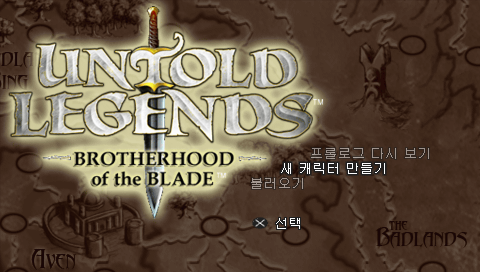
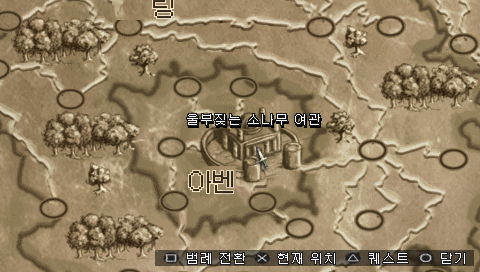
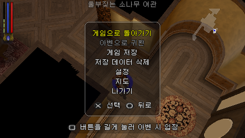

# 언톨드 레전드: 브라더후드 오브 더 블레이드 — PSP

PSP **Untold Legends: Brotherhood of the Blade** 한글 번역 패치 프로젝트입니다. 네 가지 직업으로 캐릭터를 육성하고 장비를 모으며 던전을 탐험하는 액션 RPG입니다.

> **한글 패치 v1.0 정식 배포 · 2026-10-31**

<!-- game-preview:start -->

  

**타이틀 메뉴** — 2026-10-30 현재27의 실제 PPSSPP 화면입니다. 로고와 타이틀 배경 지도명은 원문을 유지합니다.

  
  

**지도와 메뉴** — 같은 현재27 실행에서 일반 불러오기 후 확인한 화면입니다. 지도 좌표 시험이나 후기·전투·엔딩 전체 검수를 뜻하지 않습니다. 원본 캡처와 해시는 [이미지 기록](img/README_IMAGE.json)에 남겼습니다.
<!-- game-preview:end -->

## 다운로드 및 적용 방법

**[v1.0 다운로드](https://github.com/akuma815/psp-untold-legends-brotherhood-of-the-blade-kr-patch/releases/tag/v1.0)**의 Assets에서 `UntoldLegends_KR_v1.0_Windows.zip`을 받습니다. **Code → Download ZIP**은 개발 소스이며 패치 배포 ZIP이 아닙니다.

1. 아래 체크섬과 일치하는 한국판 원본 ISO를 직접 준비합니다.
2. 배포 ZIP을 새 폴더에 모두 풀고 `UntoldLegends_KR_Patcher.exe`를 실행합니다. Python이나 별도 패처 설치가 필요 없습니다.
3. 원본 ISO와 새 한글 ISO의 출력 경로를 선택하고 패치를 적용합니다. 원본과 기존 출력 파일은 덮어쓰지 않습니다.
4. PPSSPP에서 생성된 ISO를 직접 엽니다. `data`·`tools` 등 동봉 파일을 함께 유지하고, ZIP 내부의 안내를 확인합니다.

저장 선택 후 화면만 어두워지면 **이 게임의 그래픽 설정에서 ‘버퍼 효과 건너뛰기’를 끄고 다시 실행**합니다. [상세 적용·설정 안내](docs/PATCH_GUIDE.txt).

## 주의사항

- 등록 원본은 한국판 식별자 `ULKS46015` / 디스크 버전 `1.01`입니다. 다른 버전 지원은 확인하지 않았습니다.
- 원문 3,973개 중 3,569개와 분리 일지 2개, 합계 **3,571개 문안**을 확정했습니다. 사용처 미확인 404개는 이번 범위에서 제외하고 원문을 유지합니다.
- 한글 지도 25타일과 실제 로딩 문구 1개의 외관을 확정했습니다. 별도 그래픽 13개·타이틀 지도명·제작진은 원문을 유지합니다. 캐릭터 이름 입력은 원래 문자 범위입니다.
- 전체 본문 배치·후기·전투·엔딩·모든 저장 경로와 직업·실기·다른 버전의 검증은 완료하지 않았습니다. 발견한 문제는 Issues로 제보해 주세요.
- 원본 게임·완성 게임 폴더·ISO·세이브·상태 저장·비공개 복구 기록·기존 개인 검수 패키지는 포함하지 않습니다.
- 분리 PPSSPP GUI에서 저장 목록·덮어쓰기 확인·저장 완료를 확인했고, 사용자는 게임별 렌더링 설정 적용 후 저장창 정상 표시를 확인했습니다. 이동 문제도 사용자가 PPSSPP 설정 문제였다고 확인했습니다. 개인 조작 설정은 배포 ZIP에 포함하지 않습니다.

## 체크섬

| 구분 | 크기 | SHA-256 |
| --- | ---: | --- |
| 등록 원본 ISO | 407,601,152바이트 | `27bdf09512f138ed40f76f4c575fd9d373a95026355e6c8d97e300c2d4a0c621` |
| v1.0 결과 ISO | 410,986,496바이트 | `d12edc5bac1d71bfa9ef6aa78eab4991749b4aa09022106a93c0957a1711faf8` |
| 현재27 구성 명세 | 80파일 메타데이터 | `e8b97741db23f8a32d4eabe649fb7b58f18ea5c009fd9609692761cdb5f5b61a` |
| 현재 한글 원고 `entries.jsonl` | 1,820,334바이트 | `9d4990557857ffccee242bea119b4c138a449758bb0ac6fd8345c5d208c6a7da` |

배포 ZIP의 체크섬은 [릴리즈 기록](docs/releases/v1.0/RELEASE_NOTES.md)에 있습니다. 구성 명세 해시는 ISO 해시와 구분하며 개별 결과 80파일은 [입력·결과 명세](inputs/PUBLIC_INPUTS.json)에 있습니다.

## 소스 및 작업 기록

[공개 소스 구성](docs/SOURCE_GUIDE.md) · [상세 적용 안내](docs/PATCH_GUIDE.txt) · [빌드 입력과 검증](docs/rebuild/README.md) · [현재 검증 범위](docs/VALIDATION.md) · [작업 인계](docs/HANDOFF_2026-10-30.md)

**공개 소스만으로 전체 게임 재빌드를 완성하려면 별도 그래픽 입력과 어셈블러가 필요합니다.** 완성 패치를 적용하는 배포 ZIP은 해당 소스 재빌드 환경을 요구하지 않습니다.
